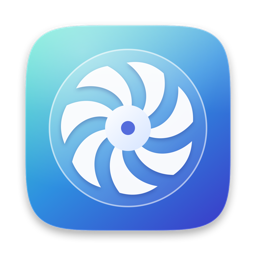

<p align="center">
  
</p>

<h1 align="center">FansCtrl</h1>

<p align="center">按场景调节 Mac 风扇：图书馆里保持安静，高负载时提前散热。</p>

<p align="center"><a href="README.md">English</a> | 简体中文</p>

FansCtrl 用来控制 Apple Silicon 和 Intel Mac 的风扇。有主窗口（概览、温度和转速曲线、档位、设置）和菜单栏面板两个入口。界面用的是原生 SwiftUI，macOS 26 及以上用 Liquid Glass，macOS 15 上换成普通的 Material 材质。

- 需要 macOS 15 或更高版本。
- 在 MacBook Pro M5（Mac17,2）上实际跑过：可以手动接管风扇，全速档测到 6574 RPM。
- Intel 机型是照着 SMC 规范适配的，有单测，但还没在真机上跑过。

## 档位

转速统一按“最小到最大转速之间的比例”来配，所以同一套档位在不同 Mac 上都能用。

| 档位 | 做法 | 适合 |
| --- | --- | --- |
| 系统默认 | 不干预 | 想要 Apple 原厂行为 |
| 图书馆 | 封顶 0.12（14 寸 M5 上约 2830 RPM）。平时交给系统，系统想转得比这更快时才接管，压在封顶值 | 图书馆、自习室、开会 |
| 安静 | 封顶 0.30 | 宿舍、办公室 |
| 均衡 | 60°C 以上按曲线调速，比系统早一点开始散热 | 日常 |
| 性能 | 50°C 起就提速，减少降频 | 渲染、编译、游戏 |
| 全速 | 满速 | 临时快速降温 |
| 智能 | 看平滑后的 CPU 负载、供电和系统热压力，在图书馆、安静、均衡、性能之间切换。升档等 8 秒，降档等 45 秒 | 懒得手动切 |

智能档有个“静音优先”开关，打开后只在图书馆和安静两档之间切，适合需要长时间保持安静的时候。

为什么用封顶，不自己写一条低速曲线？在 M5 MacBook Pro 上测过，CPU 到 90°C 时系统也只跑 2500 RPM 左右，自己调的“静音曲线”很难比这更安静。封顶的好处是图书馆和安静档不会比系统默认更吵。

代价是持续重负载时芯片会更热，可能比系统默认早一点开始轻微降频。热压力到 `serious`（马上要明显降频）或温度超过安全阀时，封顶会放开，所以不会一直处在严重降频状态。

### 强力压制

风扇突然变吵的时候用，比如在图书馆里开始编译。开启后风扇马上降到本机最低转速（不会停转），60 秒后自动交还，这段时间用来关掉占 CPU 的程序。

- 开启前会提示：噪音会降低 60 秒，请马上关闭高负载软件。
- 压制期间温度持续在 103°C（Intel 95°C）以上会提前结束，交还系统。紧急满速保护的优先级更高。
- 结束后有冷却期，时长是实际压制时间的 2 倍，最多 120 秒，避免连着压制让芯片一直处在高温。
- 睡眠前会自动结束。

```bash
fanctl suppress        # 开启
fanctl suppress off    # 提前结束
```

## 安全机制

- 只有守护进程会写 SMC。本地 socket 只接受 `status`、`setProfile`、`setQuietFirst` 三个命令，不提供任意 SMC 读写。每个连接都用 `getpeereid` 校验，只放行 root 和当前坐在屏幕前登录的用户。
- 转速始终限制在 [最小, 最大] 之间，类型或长度对不上的写入直接拒绝。
- 切到手动模式后会回读确认，固件没接受就报错。如果系统连续 3 次把风扇抢回自动，就认为这台机器不支持，不再接管。
- 紧急满速：温度到 108°C（Intel 99°C）或热压力 `critical` 时满速，降到 100°C（Intel 90°C）才恢复。
- 静音档安全阀：温度到 103°C（Intel 95°C）或热压力 `serious` 时放开封顶，交还系统，回差 6°C。
- 读不到可信的温度时，马上交还系统。
- 睡眠前、守护进程退出（SIGTERM/SIGINT/SIGHUP）和卸载时都会恢复系统自动控制。守护进程崩溃后由 launchd 拉起，启动后做的第一件事也是恢复自动。
- 无风扇机型（MacBook Air）会被识别为不支持，不做任何写入。

## 资源占用

- 守护进程 RSS 约 8 MB，CPU 几乎不占：实测跑几十秒累计 0.02–0.04 秒 CPU 时间。
- 系统默认档不跑定时器，状态用到时才读。其他档每 2 秒采样一次，温度 key 的元信息有缓存，每次采样只有一次 IOKit 调用。
- App 只在主窗口或菜单栏面板可见时轮询，都收起来以后就不再唤醒。

## 安装

在 Releases 下载 `FansCtrl-x.y.z.dmg`，把 FansCtrl 拖进“应用程序”再打开。第一次打开会提示安装后台服务，点了之后系统会要管理员密码。

App 是 ad-hoc 签名，没有经过 Apple 公证。第一次打开如果被 Gatekeeper 拦下，去“系统设置 → 隐私与安全性”里点“仍要打开”。

也可以手动装后台服务：

```bash
sudo build/FansCtrl.app/Contents/Resources/install.sh
```

会装这几个文件：`/Library/PrivilegedHelperTools/com.fansctrl.daemon`、`/Library/LaunchDaemons/com.fansctrl.daemon.plist`、`/usr/local/bin/fanctl`。卸载：

```bash
sudo build/FansCtrl.app/Contents/Resources/uninstall.sh
```

关掉主窗口后 FansCtrl 会留在菜单栏，Dock 图标也一起隐藏。风扇由后台服务控制，跟 App 开没开着没关系。

## 命令行

```bash
fanctl status            # 当前状态
fanctl set library       # system | library | quiet | balanced | performance | max | smart
fanctl quiet-first on    # 智能档静音优先
fanctl watch             # 每 2 秒刷新
fanctl probe             # 只读检测本机风扇和传感器，不需要守护进程
```

想确认本机固件接不接受手动转速，先 `fanctl set system` 或者卸载服务，免得两边同时写 SMC，然后：

```bash
sudo fanctl selftest
```

## 从源码构建

需要 Xcode 26 或更高版本（Liquid Glass 的 API 在 macOS 26 SDK 里）。

```bash
swift test
```

```bash
./scripts/build-app.sh
```

```bash
./scripts/build-dmg.sh
```

产物在 `build/`。图标是 `scripts/make-icon.swift` 用 CoreGraphics 画的，没用 SF Symbols，因为它的许可不允许用在 App 图标上。生成好的图标已经提交在 `Support/AppIcon.icns`，改了脚本以后这样重新生成：

```bash
swift scripts/make-icon.swift build/icon && iconutil -c icns build/icon/AppIcon.iconset -o Support/AppIcon.icns
```

不写 SMC、不用 root 的调试方式（socket 路径要短于 104 字节）：

```bash
.build/debug/fanctld --dry-run --socket .build/dev.sock --config .build/dev-config.json
```

```bash
FANSCTRL_SOCKET=.build/dev.sock .build/debug/fanctl status
```

dry-run 输出里，“下发”列是守护进程打算写入的转速，“SMC目标”是系统当前实际用的目标转速。

### 目录结构

```
Sources/CSMC        AppleSMC 用户态客户端（C，保证 80 字节结构布局）
Sources/FanCore     SMC 编解码、机型探测、档位策略、控制器、智能选档、IPC 协议
Sources/fanctld     root 守护进程：控制循环、socket 服务、睡眠和信号处理
Sources/fanctl      命令行工具
Sources/FansCtrlApp 主窗口和菜单栏面板（SwiftUI、Swift Charts、Liquid Glass）
Support/            Info.plist、App 图标、安装/卸载脚本
scripts/            构建 App 和 DMG、生成图标
```

### 机型适配

- Apple Silicon：模式 key 是 `F0md`（或 `F0Md`）。温度取 `Tp*`/`Te*`（CPU）和 `Tg*`（GPU）里有效读数的最大值。如果有 `Ftst` 解锁 key，接管前先写 1，恢复时清零。
- Intel：新机型用 `F0Md`，老机型用 `FS! ` 位掩码。温度来自 `TC0P`/`TC0D`/`TCxC`、`TG0P` 等 key，转速是 `fpe2` 定点数。

## 免责声明

FansCtrl 直接通过 SMC 控制风扇。虽然做了几层保护（转速限幅、过热放开封顶、紧急满速、出错时交还系统），改动散热行为还是有风险，请自己权衡后再用。

## 许可证

[MIT](LICENSE)
